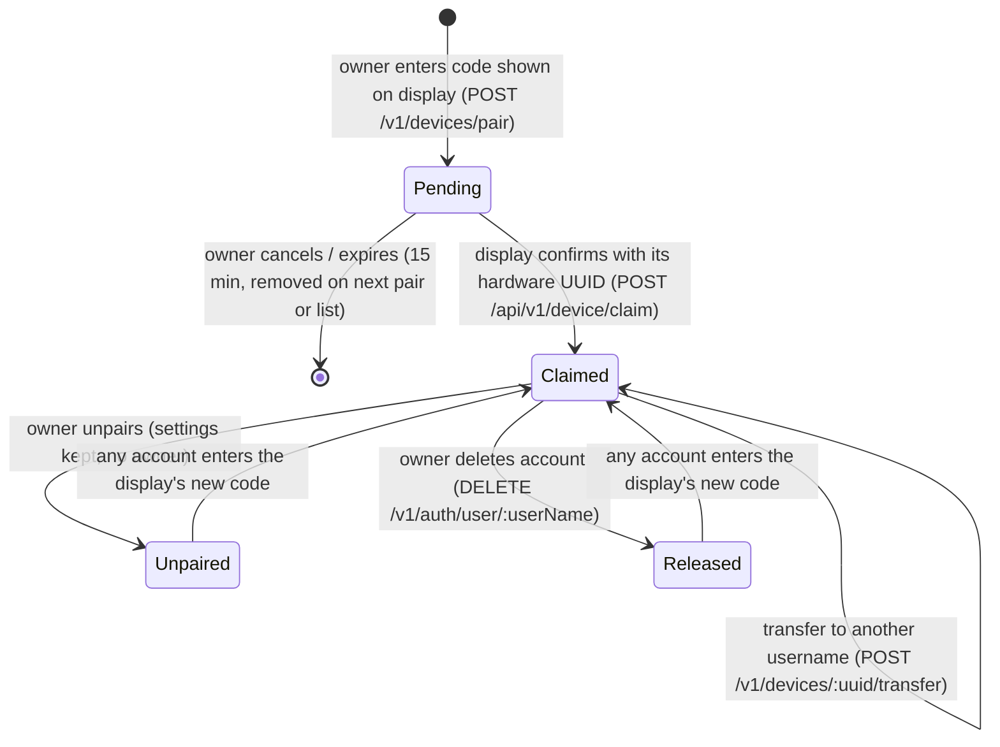
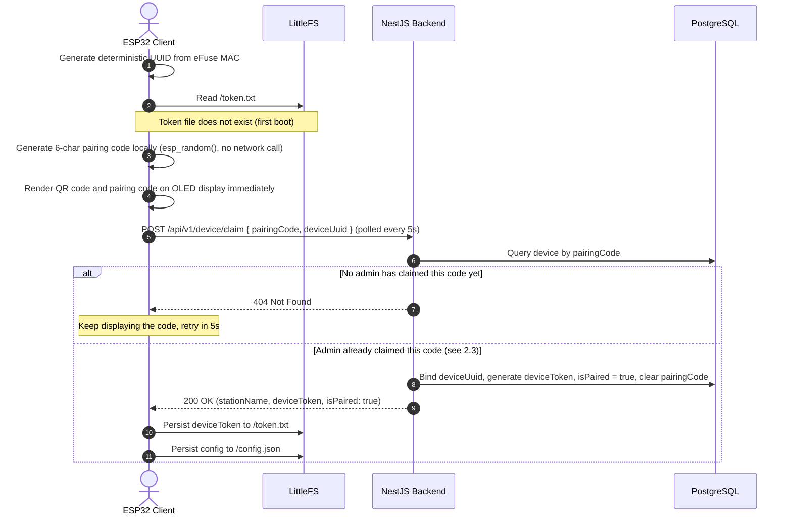
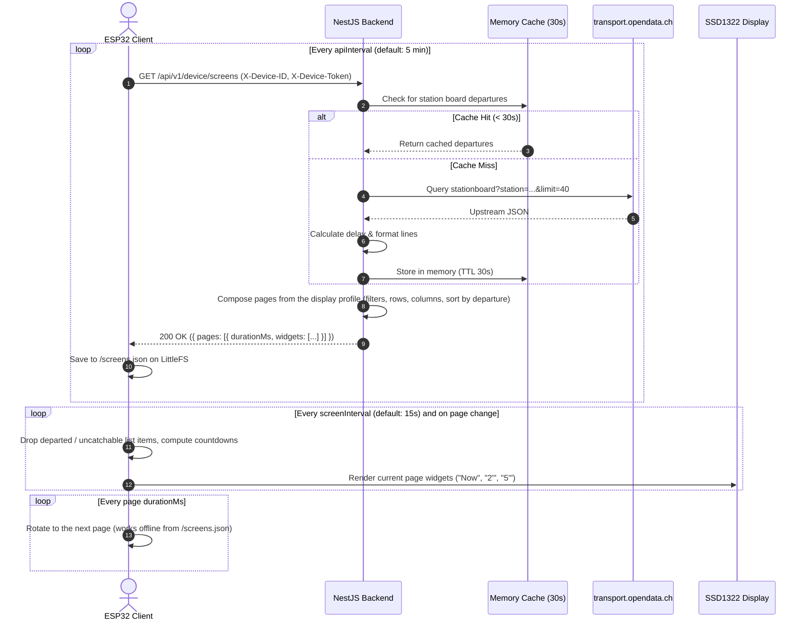
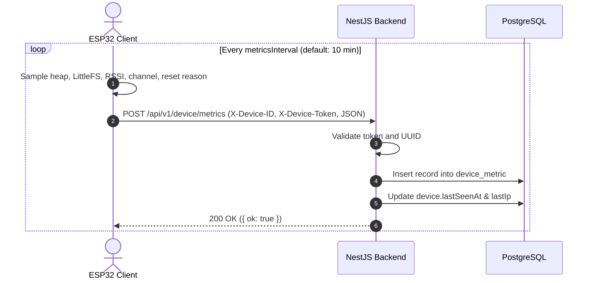

# Architecture Overview

The **Public Transport Spy** platform is organized as a three-tier monorepo architecture:
1. **`on-chip-software/`**: ESP32 C++ firmware driving an SSD1322 OLED display with local LittleFS storage, Wi-Fi captive portal, and QR code rendering.
2. **`api/`**: Modular NestJS 11 backend providing hardware device gateways, Swiss transit aggregation, user authentication, and administrative endpoints backed by PostgreSQL 18.
3. **`frontend/`**: Next.js 16 (App Router) web dashboard with Material UI, cookie-based session authentication, and Backend-For-Frontend (BFF) proxying.

```
 +-------------------------------------------------------------------------+
 |                     ESP32 Client (on-chip-software)                     |
 |  [src/main.cpp] -> [src/display.cpp] -> [SSD1322 OLED]   [LittleFS]    |
 +-------------------------------------------------------------------------+
                     | (X-Device-ID, X-Device-Token)
                     | Wi-Fi / HTTPS (/api/v1/device/*)
                     v
 +-------------------------------------------------------------------------+
 |                       NestJS Backend API (api)                          |
 |  +-----------------------+   +--------------------+   +--------------+  |
 |  |  DeviceClientModule   |   |   TransitModule    |   | AuthModule   |  |
 |  |   (/api/v1/device/*)     |   |  (Cache + SBB API) |   | (/v1/auth/*) |  |
 |  +-----------------------+   +--------------------+   +--------------+  |
 |  +-----------------------+   +--------------------+   +--------------+  |
 |  |   DeviceAdminModule   |   |   DatabaseModule   |   | AdminApiKey  |  |
 |  |     (/v1/devices)     |   |     (TypeORM)      |   |    Guard     |  |
 |  +-----------------------+   +--------------------+   +--------------+  |
 +-------------------------------------------------------------------------+
      ^                                      |                   |
      | (X-Api-Key)                          v                   v
 +----+----------------------------+   +-----------+     +---------------+
 |      Next.js Frontend (frontend)|   |PostgreSQL |     |Swiss OpenData |
 |  +----------------------------+ |   |    18     |     | (Stationboard)|
 |  | App Router UI (MUI 9)      | |   +-----------+     +---------------+
 |  | Login, Register, Profile   | |
 |  | Device Pairing & Settings  | |
 |  +----------------------------+ |
 |  | BFF API Proxy (/api/v1/*)  | |
 |  | Session Auth (Jose JWT)    | |
 |  +----------------------------+ |
 +---------------------------------+
```

---

## 1. System Components

### 1.1 ESP32 Microcontroller Client (`on-chip-software/`)
- **Hardware Platform:** ESP32-WROOM-32 / ESP32 DevKit v1 (Xtensa dual-core @ 240 MHz, 520 KB SRAM, 4 MB SPI Flash).
- **Display Driver:** U8g2 library driving a 256x64 SSD1322 4-wire hardware SPI yellow/white OLED.
- **Identity & Authentication:**
  - Random per-install UUID (hardware RNG, stored in `/id.txt`, regenerated by factory reset); never MAC-derived.
  - Secret `deviceToken` issued by backend on initial boot and saved in `/token.txt` on LittleFS.
  - Required headers on every subsequent call: `X-Device-ID: <UUID>` and `X-Device-Token: <Token>`.
- **Wi-Fi & Server Provisioning:** Integrated `WiFiManager` captive portal (`PTSpy-Setup-xxxx`; reopened with a short BOOT press, factory reset by holding BOOT 10 s) allowing zero-code configuration of Wi-Fi credentials and the backend server URL.
- **Resilience:** Dual-layer LittleFS offline fallback (`/config.json` and `/screens.json`), ensuring countdown rendering continues even during network drops.
- **Pairing UX:** Built-in QR code generator (58x58 px, Version 3) and 6-character human-readable code displayed side-by-side during unpaired state.

### 1.2 NestJS Backend API (`api/`)
- **Framework:** NestJS 11 on Node.js 24 with TypeScript.
- **Logging:** Structured JSON logging in production via `nestjs-pino`, formatted single-line pretty printing in development.
- **Validation:** Global `ValidationPipe` (`whitelist: true, forbidNonWhitelisted: false, transform: true`): unknown properties are stripped, not rejected, so firmware and backend versions can drift. Environment variables validated at startup via `zod`.
- **Security Boundary:**
  - `AdminApiKeyGuard`: Enforces `X-Api-Key` header with fail-closed security. Strips URL query parameters before path matching.
  - Exact public matches: `/healthz`, `/docs`, `/docs-json`, `/v1/auth/register`, `/v1/auth/login`.
  - Public prefixes: `/api/v1/device/*`, `/v1/transit/*`.
  - Protected paths: `/v1/devices/*`, `/v1/auth/user/:userName`.
- **Rate Limiting:** `@nestjs/throttler` (in-memory) on registration, login, pairing and device claim.
- **Persistence:** TypeORM with PostgreSQL 18, migrations run automatically on startup (`migrationsRun: true`). See [§1.5 Data Model Conventions](#15-data-model-conventions).
- **Screen composer:** `device/screens/screen-composer.ts` turns each device's display profile (pages the owner configures) plus live departures into the widget layout the firmware renders (`GET /api/v1/device/screens`). All layout logic lives here, so new presets ship without firmware updates.

### 1.3 Next.js Web Frontend (`frontend/`)
- **Framework:** Next.js 16 with App Router, React 19.3, and Turbopack.
- **UI Kit:** Material UI 9 (`@mui/material-nextjs/v16-appRouter`) styled with Tailwind CSS 4, dark mode theme by default. MUI styles live in `@layer mui`; global CSS must stay inside `@layer base` (unlayered rules beat every MUI style).
- **Authentication:**
  - Stateless session cookies encrypted using `jose` JWTs (`session` cookie, HTTP-only, SameSite: Lax).
  - User session states: Anonymous, Authenticated User (`USER` / `ADMIN`).
- **Backend-For-Frontend (BFF):**
  - Next.js Route Handlers in `frontend/src/app/api/v1/` proxy authenticated user actions to NestJS.
  - The BFF securely injects `X-Api-Key: ADMIN_API_KEY` when communicating with protected NestJS endpoints, keeping administrative credentials server-side and hidden from browser clients.
- **Key Views:**
  - `/login` & `/register`: Public user account access with validation and error alerts.
  - `/profile`: User account overview, role, password change, and account deletion (password + typed confirmation; releases the user's displays).
  - `/`: Dashboard showing each display's real composed screens (compact live preview), online/offline/switched-off status, pending pairings with their code, and quick links.
  - `/pair`: Interactive pairing wizard supporting 6-character code entry with live feedback.
  - `/admin` (admins only): fleet telemetry dashboard built with MUI X Charts: online/offline/pending/switched-off counts, status donut, per-device heap, Wi-Fi signal, uptime (reboots) and storage charts over 24 h / 3 / 7 days. Role checked server-side on every BFF call.
  - `/devices/[uuid]`: Display settings manager (transfer to another account by username, station selection, time zone picker (MUI Autocomplete over the API's supported IANA zones), intervals, font theme, **Display power** (on/off switch and daily on/off schedule with weekdays), **Screens** editor for up to 6 rotating pages, status, and unpairing) with a **live preview**: the unsaved form is composed by the backend (`POST /v1/devices/:uuid/screens/preview` via the BFF) and drawn on a 256x64 canvas with the firmware's own row/countdown rules (`react/feature/device/screen-preview`).

### 1.4 External Transit Provider
- **Source:** Swiss Federal Railways Open Data via `https://transport.opendata.ch/v1/stationboard` (40 departures per station, so screen filters still fill their rows).
- **Aggregator:** In-memory 30-second TTL cache in `TransitService` protecting upstream rate limits and guaranteeing sub-10ms response times for embedded displays. Departures carry `timestamp` (delay included), `line`, `destination`, `category`, `platform`, `delayMinutes`.

### 1.5 Data Model Conventions
- **Entities** (`User`, `Device`, `DeviceMetric`, registered in `database/entities.ts`) all extend `AbstractEntity`:
  - `id`: UUIDv7 primary key generated by PostgreSQL 18's native `uuidv7()` (`DEFAULT uuidv7()`), time-ordered so inserts stay index-friendly. TypeORM reads it back via `INSERT ... RETURNING`.
  - `createdAt` / `updatedAt`: `timestamptz`, maintained by TypeORM.
- **No `bigint` columns:** the `pg` driver returns int8 as strings. Telemetry counters are `integer`, and the input DTO enforces `0..2147483647` (invalid values get `400`).
- **Explicit names** for every index and foreign key (`IDX_<table>_<column>`, `FK_<table>_<column>`), so the migration and the entities match exactly. `npm run migration:generate -- <path> --dryrun` reports *No changes* when they are in sync.
- **Entity → DTO:** entities never leave the service layer. Every response DTO extends `AbstractDto` (`id`, `createdAt`, `updatedAt` as ISO strings) and is built by a mapper that spreads `toAbstractDto(entity)`: `toUserDto` (auth), `toDetailDto` (devices; never exposes `deviceToken` or a paired device's `pairingCode`), `toMetricDto` (telemetry), `toConfigResponse` (device config).
- **JSON columns:** `device.display` (`jsonb`) stores the owner's screen profile, validated by `DisplayProfileDto` (types/limits enforced, `null` = default board).

---

### 1.6 Device Ownership Lifecycle

Rules:
- **A hardware UUID belongs to exactly one account** (unique index on `device.deviceUuid`). A claim for a UUID registered to another account is refused (`403`); the display shows "Registered to another account" and keeps polling.
- **An account may own any number of displays.** Usernames are unique (lowercased), and transfers address accounts by username.
- **A UUID is freed** when its owner unpairs the display, transfers it, or deletes their account.
- **Claimed displays are only ever addressed by their hardware UUID.** Only pending requests (no UUID yet) are addressed by their internal id, for cancelling.



- **Pending:** a row with `deviceUuid = null`, bound to the account that entered the code first (others get `409`).
- **Unpaired / Released:** the device keeps its `deviceToken`; on its next config poll it receives a backend-issued pairing code and shows it. *Released* additionally resets the personal settings (`RELEASED_DEVICE_RESET`: name, screens, schedule, on/off), so the next owner sees nothing of the previous one. Telemetry history stays with the hardware.
- **Account deletion** (password required) runs in one transaction: delete pending requests → release displays → delete the user.

---

## 2. End-to-End Sequence Flows

### 2.1 First Boot: Local Pairing Code & Claim

The hardware UUID is deterministic (MD5 of a hardcoded salt + eFuse MAC) and therefore guessable.
An unrecognized UUID is never auto-registered by the backend — doing so would let an attacker who
guesses or observes a device's UUID register it first and steal its pairing code before the real
owner ever sees it. Instead, the ESP32 picks its own pairing code locally, and that code — never
the UUID — is the only thing that needs to stay secret until an admin has claimed it.



### 2.2 Subsequent Boot & Config Fetch (Token Protected)

```mermaid
sequenceDiagram
    autonumber
    actor ESP as ESP32 Client
    participant FS as LittleFS
    participant API as NestJS Backend
    participant DB as PostgreSQL

    ESP->>FS: Read /token.txt
    FS-->>ESP: Return stored token
    ESP->>API: GET /api/v1/device/config (X-Device-ID, X-Device-Token)
    API->>DB: Query device by deviceUuid
    API->>API: Constant-time comparison: providedToken == device.deviceToken
    alt Token Missing or Invalid
        API-->>ESP: 401 Unauthorized
        Note over ESP: Re-authentication failure; alert on OLED
    else Token Matches
        API->>DB: Update lastSeenAt, lastIp
        API-->>ESP: 200 OK (stationName, timezone, intervals, theme, isPaired)
        ESP->>FS: Update /config.json
    end
```

### 2.3 User Pairing Claim Sequence

```mermaid
sequenceDiagram
    autonumber
    actor ESP as ESP32 OLED
    actor User as User (Browser/Phone)
    participant BFF as Frontend BFF
    participant API as NestJS Backend
    participant DB as PostgreSQL

    Note over ESP: Display shows QR Code + "KV7-9P2" (locally generated, see 2.1)
    ESP->>API: POST /api/v1/device/claim { pairingCode, deviceUuid } (5s fast-poll)
    API-->>ESP: 404 Not Found (nobody has claimed this code yet)

    User->>User: Scans QR code or navigates to /pair
    User->>BFF: POST /api/v1/devices { pairingCode: "KV7-9P2", name: "Living Room", stationName: "Bern" }
    Note over BFF: Verifies user session cookie (jose JWT)
    BFF->>API: POST /v1/devices/pair (X-Api-Key: ADMIN_API_KEY, userId: session.userId)
    API->>DB: Find or create pending device row by pairingCode (deviceUuid still null)
    API->>DB: Bind userId, name, stationName; refresh pairingCodeExpiresAt (15 min)
    API-->>BFF: 200 OK (DeviceDetailDto, deviceUuid: null, isPaired: false)
    BFF-->>User: 200 OK (Pairing Success redirect to /)

    ESP->>API: POST /api/v1/device/claim { pairingCode, deviceUuid } (next 5s poll)
    API->>DB: Find pending row by pairingCode, verify unexpired
    API->>DB: Bind deviceUuid, generate deviceToken, isPaired = true, clear pairingCode
    API-->>ESP: 200 OK (stationName: "Bern", deviceToken, isPaired: true)
    ESP->>ESP: Clear pairing screen, initialize live departure board!
```

### 2.4 Screen Polling & Rendering



### 2.5 Hardware Health Telemetry Ingestion



---

## 3. Security Architecture & Threat Mitigation

| Threat Vector | Mitigation Strategy | Implementation |
|---|---|---|
| **Device Spoofing / Impersonation** | Per-device secret `deviceToken` issued only after a pairing-code claim, stored in LittleFS `/token.txt`. | `timingSafeEqual` constant-time comparison in `DeviceService`. Subsequent requests without token are rejected (`401`). |
| **Device Squatting / Metrics Poisoning** | Unknown device IDs cannot submit metrics or claim existing devices. | `recordMetrics` returns `404 Not Found` if UUID is not registered. UUIDs are strictly regex-validated (`/^[A-Za-z0-9_-]{4,64}$/`). |
| **UUID Front-Running (TOFU race)** | The guessable hardware UUID (MD5 of a public salt + eFuse MAC) is never trusted on its own. | `GET /api/v1/device/config` returns `404` for unregistered UUIDs instead of auto-registering them; a device only becomes known via `POST /api/v1/device/claim`, which requires a pairing code an admin already claimed. |
| **Credential & Secret Leakage** | `deviceToken` and expired `pairingCode` values are never exposed to browser clients or API consumers. | `toDetailDto()` sanitizes device objects, explicitly omitting secret tokens from all DTO responses. |
| **User Enumeration & Unauthorized Profile Edits** | User detail (`GET /v1/auth/user/:userName`) and edit endpoints are blocked to anonymous callers. | `AdminApiKeyGuard` strictly guards `/v1/auth/user/*`. Only exact public paths (`/v1/auth/register`, `/v1/auth/login`) are accessible anonymously. |
| **Bcrypt Silent Truncation Attack** | Bcrypt ignores password bytes beyond 72 bytes. Attackers can append arbitrary characters. | `RegisterDto` and `LoginDto` enforce `@MaxLength(72)`. |
| **Timing Attacks on Login** | Unknown usernames could be inferred by comparing response times with existing users. | `AuthService` performs constant-time dummy bcrypt comparison for missing usernames. |
| **Brute Force Registration & Login** | `@nestjs/throttler`: per IP for `device/claim`, per client IP + username for login (the BFF forwards the browser IP in `X-Client-Ip`). | `ThrottlerGuard` / `LoginThrottlerGuard` throttle abuse, returning `429 Too Many Requests`. |
| **BFF Privilege Separation** | Browser clients never possess `ADMIN_API_KEY`. They authenticate via HTTP-only encrypted session cookies. | Next.js server-side Route Handlers inject `ADMIN_API_KEY` exclusively on backend fetch requests. |
| **Device Takeover via Claim** | A hardware UUID belongs to one account. | A claim for a UUID registered to another account is refused with `403` and nothing changes; only ownerless leftovers or the same account's earlier row are replaced. Covered by `device-ownership.int-spec.ts`. |
| **Pending Request Takeover** | A pending pairing request belongs to the account that entered the code first. | Others get `409`. `DELETE /v1/devices/pending/:id` only deletes the owner's own pending rows (owner taken from the session by the BFF). |
| **Transfer Abuse** | Only the current owner may hand a display over. | `POST /v1/devices/:uuid/transfer` is checked by the BFF (session) and again by the API (`fromUserName` must match); non-owners get `404`. |
| **Leaked Displays on Account Deletion** | A deleted account must not leave a display showing its data. | `DELETE /v1/auth/user/:userName` needs the password (rate limited) and releases the displays in one transaction with personal settings cleared, so they can be claimed again. |
| **Broken Access Control in the BFF** | The API has no per-user authorization. | Every single-resource BFF route verifies the session and `device.userId === session.userId`, answering `404` otherwise (see CLAUDE.md, Frontend Conventions). |

---

## 4. Resilience & Failure Handling

| Failure Mode | Detection | System Behavior |
|---|---|---|
| **Wi-Fi Loss** | `WiFi.status() != WL_CONNECTED` | ESP32 switches to offline mode, loads `/screens.json` from LittleFS, displays `[OFFLINE]` badge on OLED, and renders remaining cached departures until they expire. |
| **Upstream Transit Outage** | HTTP 5xx or timeout from `transport.opendata.ch` | NestJS `TransitService` serves the stale cache if available, otherwise answers `503`; it **never invents departures**. The screen composer then sends the honest message `Timetable temporarily unavailable` (and `No departures scheduled right now` when a station has nothing coming, e.g. at night). |
| **Database Disconnection** | PostgreSQL pool failure | Device data endpoint continues operating using default/cached station names; errors logged via Pino with alertable error levels. |
| **Unpaired / First Boot** | Device has never been claimed (no stored `deviceToken`) | ESP32 generates its own 6-character pairing code locally and displays it on OLED immediately; polls `POST /api/v1/device/claim` every 5 seconds until an admin has claimed the code via `/pair`. |
