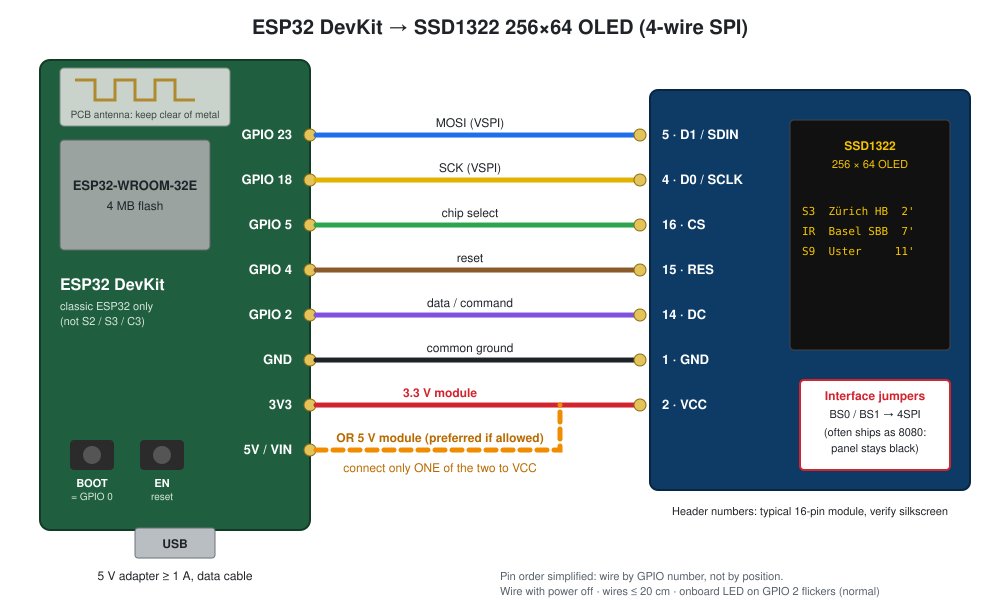

# Hardware Guide: Choosing, Wiring and Powering a Board

What to buy, how to connect the SSD1322 display, and how to power it reliably. For the firmware internals see [on-chip-firmware.md](on-chip-firmware.md); for building and flashing see [on-chip-software/README.md](../on-chip-software/README.md).

---

## 1. Shopping List

| Part | Recommendation | Notes |
|---|---|---|
| ESP32 board | **ESP32 DevKit V1 / DevKitC with ESP32-WROOM-32E**, 4 MB flash | See §2 for what to check |
| Display | **3.12" 256×64 OLED, SSD1322 controller**, SPI capable (yellow, white, green or blue) | See §3 |
| Wires | 7 jumper wires, female-female for header-to-header, ≤ 20 cm | Short wires matter at 10 MHz SPI |
| USB cable | A **data** cable (Micro-USB or USB-C, matching the board) | Charge-only cables are the #1 "board not detected" cause |
| Power supply | 5 V USB adapter, **≥ 1 A** | See §5 |
| Optional | Push button, enclosure, 100–470 µF electrolytic capacitor | Button: §6, capacitor: §5 |

---

## 2. Choosing an ESP32 Board

### Must have
- **The classic ESP32 chip** (ESP32-D0WD, in a WROOM-32, WROOM-32E, WROOM-32U or WROVER module). The firmware is built for `esp32dev` and uses the classic chip's VSPI pins. **ESP32-S2, -S3, -C3, -C6 and -H2 are different chips** with different pins and toolchains. They will not run this firmware without porting.
- **At least 4 MB flash.** The `huge_app.csv` partition table needs a 3 MB app slot plus storage. Almost every WROOM-32 board has 4 MB. To check a board you already have:
  ```bash
  pio pkg exec -p tool-esptoolpy -- esptool.py --port /dev/ttyUSB0 flash_id   # look for "Detected flash size: 4MB"
  ```
- **A BOOT button on GPIO 0.** The firmware uses it at runtime: a short press opens the Wi-Fi setup and a 10 s hold does a factory reset. Every DevKit has one. Mini boards without it need an external button (§6).
- **A USB-to-serial chip with auto-reset** (CP2102, CH340 or CH9102). With auto-reset, `pio run -t upload` works without pressing buttons.

### Nice to have
- **ESP32-WROOM-32E** (chip revision v3) rather than the original WROOM-32: it has fixes for older silicon errata. Both work.
- **CP2102** rather than CH340 if you develop on macOS or Windows, because drivers are more often preinstalled. On Linux both work out of the box (see §7 for permissions).
- **WROOM-32U** (U.FL connector + external antenna) if the board ends up in a metal case or far from the router.

### Avoid
- Boards that already use GPIO 2, 4, 5, 18 or 23 for onboard peripherals. Examples are boards with a built-in display, camera or SD card (TTGO T-Display, ESP32-CAM, etc.). An onboard **LED on GPIO 2 is fine**: it just flickers along with the display's DC line.
- Boards with only 2 MB flash (rare, mostly no-name "ESP32 mini" boards).

### Pin labels
30-pin and 38-pin DevKits place the pins differently. **Always wire by GPIO number** (silkscreen `D23`, `G23`, `IO23` or `23`), never by physical position from a photo of another board.

### Wi-Fi
The ESP32 only supports **2.4 GHz** Wi-Fi with WPA2-Personal (or WPA2/WPA3 mixed). A 5 GHz-only network, WPA2-Enterprise (802.1X) or a hotel-style captive portal won't work.

---

## 3. Choosing and Preparing the Display

The firmware drives the panel with U8g2's `U8G2_SSD1322_NHD_256X64_F_4W_HW_SPI` constructor. It matches the common 3.12" 256×64 SSD1322 modules (Newhaven NHD-3.12-25664 and the widely sold compatible modules).

### Check before ordering
- Controller **SSD1322**, resolution **256×64**. SSD1306/SH1106 (128×64) and SSD1325/SSD1327 panels are different controllers and will stay black.
- The listing mentions **SPI** (often "8080 / 6800 / 4SPI / 3SPI selectable"). Some cheap listings are parallel-only.

### Set the interface to 4-wire SPI
Most modules **ship in 8080 parallel mode**. The controller's `BS0`/`BS1` inputs select the interface. On modules this is done with jumper pads or 0 Ω resistors next to a silkscreen table such as `80XX / 68XX / 3SPI / 4SPI`. Move the jumpers or resistors to the **4SPI** position as described by the module's datasheet or silkscreen. A panel in the wrong mode stays black while the ESP32 runs normally.

On a module set to SPI, the unused parallel data and control lines are tied off on the board. If you build with a bare panel, tie them as the SSD1322 datasheet specifies for serial mode.

### Display pin names
| Function | Names you'll see on the module |
|---|---|
| SPI clock | `D0`, `SCLK`, `SCK`, `CLK` |
| SPI data in | `D1`, `SDIN`, `MOSI`, `DIN`, `SDA` |
| Chip select | `CS`, `/CS` |
| Data / command | `DC`, `D/C`, `RS`, `A0` |
| Reset | `RES`, `/RES`, `RST` |
| Power | `VCC` / `VDD`, `GND` / `VSS` |

On the common 16-pin modules the usual layout is: `1 GND`, `2 VCC`, `4 D0/SCLK`, `5 D1/SDIN`, `14 DC`, `15 RES`, `16 CS`, other pins unused in SPI mode. **Verify against your module's silkscreen**, because layouts vary between vendors.

---

## 4. Wiring

| Display | ESP32 GPIO | Why this pin |
|---|---|---|
| `D0` / SCLK | **GPIO 18** | VSPI hardware clock |
| `D1` / SDIN | **GPIO 23** | VSPI hardware MOSI |
| `CS` | **GPIO 5** | VSPI default chip select |
| `DC` | **GPIO 2** | Data / command |
| `RES` | **GPIO 4** | Reset, pulsed at boot |
| `VCC` | **3V3** or **5V/VIN** | See §5, depends on the module |
| `GND` | **GND** | Common ground |

There is no MISO: the panel is write-only. The pins are defined once, in the U8g2 constructor in `on-chip-software/src/display.cpp`. If you change them, also update this table, the diagram (`docs/images/wiring-diagram.svg`), [on-chip-firmware.md §2](on-chip-firmware.md#2-wiring--pinout-hardware-spi) and §8.4 there.



### Wiring rules
- **Wire with everything unplugged.** Never connect or disconnect the display while the board is powered.
- **Keep wires short** (≤ 20 cm) and the clock wire away from the power wires. The bus runs at 10 MHz; long loose jumpers cause a garbled or shifting image.
- **One common ground** between the ESP32, the display and any external supply.
- **Strapping pins:** GPIO 0, 2 and 5 decide the boot mode at reset. The display inputs are high-impedance, so standard boards still boot and flash normally. If a board refuses to enter flash mode with the display attached, hold BOOT during upload or unplug the `DC` wire while flashing.

---

## 5. Power

### Budget
| Consumer | Typical | Peak |
|---|---|---|
| ESP32 with Wi-Fi | ~100 mA | **~250–400 mA** for milliseconds while transmitting |
| SSD1322 OLED | Tens of mA (a departure board is mostly black) | Over 100 mA with many lit pixels (module-dependent) |
| Panel in power-save ("display off") | a few mA | |

The current peaks are short, but they are what makes a board fail (see Brownouts below).

### Which pin powers the display
Check the module's datasheet or silkscreen for its supply range. The OLED panel itself needs about 12–15 V, which the module generates on board from `VCC`.
- **Module accepts 3.3 V:** connect `VCC` to the board's **3V3** pin. That's the simplest option, but the display then shares the board's small 3.3 V regulator with the ESP32's Wi-Fi peaks.
- **Module accepts 5 V:** prefer the **5V/VIN** pin, which comes straight from USB. This takes the display load off the 3.3 V regulator. The signal lines stay at 3.3 V, which the SSD1322 logic (VDDIO) expects.
- **Never** feed 5 V to a module that is specified for 3.3 V only.

### Supply
- Use a **5 V adapter rated ≥ 1 A** and a short, decent cable. Thin or long cables drop enough voltage to cause resets during Wi-Fi bursts.
- A laptop port or an unpowered USB hub is fine for development, but not for a board that runs 24/7.
- Don't connect an external 5 V supply to the **5V/VIN** pin while USB is plugged in, unless the board has a protection diode on its USB input (check its schematic).

### Brownouts
Symptom: the board resets when Wi-Fi connects or during HTTPS requests. The serial log shows `Brownout detector was triggered`, and the admin telemetry page shows **Last reset: Brownout** (reset reason 9). In order of what to try:
1. Better supply and cable (≥ 1 A, short cable).
2. Move the display's `VCC` to 5V/VIN if the module allows it.
3. Add a 100–470 µF electrolytic capacitor across **3V3 and GND**, close to the ESP32 module (mind the polarity).

Don't disable the brownout detector. It protects the flash from corrupted writes at low voltage.

---

## 6. Enclosure and Button

- **3D-printed housing.** [`hardware/housing/`](../hardware/housing) has a parametric OpenSCAD model (`housing.scad`) and ready-made `shell.stl` / `cover.stl` for a 3.12" module plus an ESP32 DevKit. Module and board dimensions vary between vendors: measure yours with calipers and adjust section 1 of the `.scad` file before printing. It already has a USB cutout and a paper-clip hole for the BOOT button.
- **Keep the BOOT button reachable.** Owners need it to change Wi-Fi (short press) and to factory reset (hold 10 s). Plan a hole, or wire an external push button between **GPIO 0 and GND**. It works in parallel with the onboard button, and the firmware enables the internal pull-up. Don't add a capacitor to that line, because GPIO 0 is also a strapping pin.
- **Antenna.** The PCB antenna is the end of the module without copper pour. Keep it clear of metal (the display's metal frame, metal cases, screws), ideally sticking out past the edge of the carrier board. In a metal case, use a WROOM-32U with an external antenna.
- **Heat.** Power draw is low, but leave a few ventilation slots in a closed case, especially with the 3.3 V regulator feeding the display.
- **Strain relief** for the USB cable, so a pulled cable doesn't rip the connector off the board.
- **OLED burn-in.** The firmware handles it (pixel shift, night dimming, panel off on schedule), but avoid mounting the display where it shows a static image 24/7 at full brightness with no schedule.

---

## 7. First Power-On Checklist

1. **Board alone first.** Plug in only the ESP32 and flash it (`npm run firmware:upload` from the repo root). On Linux, add yourself to the serial group once and log in again: `sudo usermod -aG dialout $USER` (on Arch: `uucp`).
2. Open the serial monitor (`pio device monitor -d on-chip-software`). The log should show the boot and either `Wi-Fi connected` or the setup portal starting.
3. **Unplug USB, wire the display** (§4), check `VCC`/`GND` twice, then plug in again.
4. The OLED should show **Wi-Fi Setup** (first boot) or the pairing code. Continue with the owner setup in [on-chip-software/README.md](../on-chip-software/README.md#first-boot-owners-view).

### Troubleshooting

| Symptom | Likely cause |
|---|---|
| Board not detected / no serial port | Charge-only USB cable; missing CP210x/CH34x driver (macOS/Windows); no `dialout` permission (Linux) |
| Upload fails with `Failed to connect to ESP32` | Hold BOOT while the upload starts; disconnect `DC` (GPIO 2) while flashing; try a lower `upload_speed` in `platformio.ini` |
| Panel stays black, serial log normal | Interface not set to 4-wire SPI; `VCC` at the wrong voltage; `CS`/`DC` swapped; not an SSD1322 |
| Garbled, mirrored or shifting image | Loose or long clock/data wires; partially wrong jumper setting; a panel variant that needs a different U8g2 constructor |
| Image present but very dim | Night window active (23:00–06:00 by default); low `contrast` from the server |
| Resets when Wi-Fi connects | Brownout, see §5 |
| Onboard LED flickers | Normal: the LED shares GPIO 2 with the display's `DC` line |
| Weak or dropping Wi-Fi | Antenna near metal; 5 GHz-only network; distance to the router |
| `Server unreachable (-1)` on the pairing screen | Wrong backend URL (a dev build needs the LAN IP, not `localhost`); self-signed HTTPS certificate |
